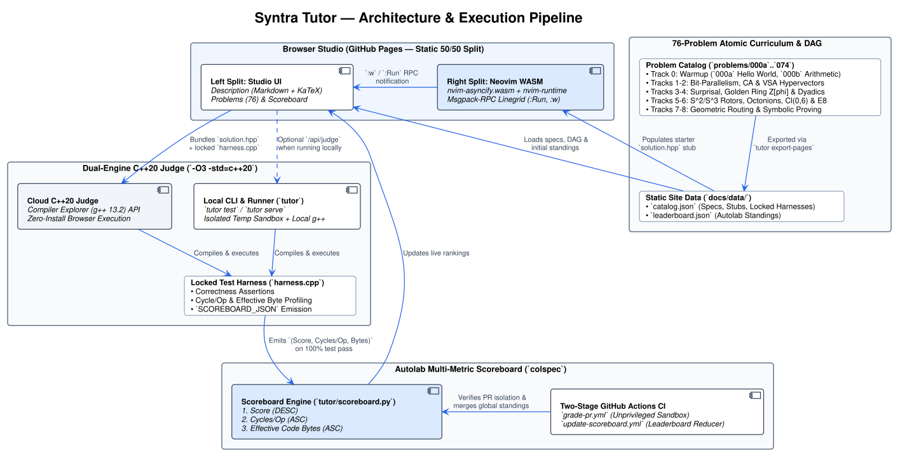

Open the [Production Web Studio](https://syntra-labs.github.io/tutor/), preview the [Dev Web Studio](https://syntra-labs.github.io/tutor/dev/), or run `tutor serve` to test locally at [http://localhost:8080](http://localhost:8080). Solve problems. Score higher in the leaderboard.

