# Atomic Problem Roadmap: Advanced Mathematics, Geometry & ML Systems (`001`–`074`)

> **Design Principle:** Match the exact granularity of `002-hypervector-hamming` and `004-ca184-demarcation`. Every problem isolates **one atomic mathematical law, operator, or data structure primitive** (typically 10–35 lines of code) so students build intuition step-by-step and compose earlier primitives into higher-tier engines.

---

## 1. Master Dependency Graph (8 Progressive Tracks)

```mermaid
flowchart TD
    classDef t1 fill:#1e293b,stroke:#475569,color:#fff
    classDef t2 fill:#1e3a8a,stroke:#3b82f6,color:#fff
    classDef t3 fill:#065f46,stroke:#10b981,color:#fff
    classDef t4 fill:#701a75,stroke:#d946ef,color:#fff
    classDef t5 fill:#0f766e,stroke:#14b8a6,color:#fff
    classDef t6 fill:#4c1d95,stroke:#8b5cf6,color:#fff
    classDef t7 fill:#9a3412,stroke:#f97316,color:#fff
    classDef t8 fill:#881337,stroke:#f43f5e,color:#fff

    subgraph Track1 ["Track 1: Bit-Parallelism, Cellular Automata & Ternary Logic (001-012)"]
        P002["002: Popcount & Hamming"]:::t1 --> P005["005: FNV-1a & SplitMix64"]:::t1
        P004["004: CA Rule 184 Step"]:::t1 --> P006["006: CA Rule 30 Step"]:::t1
        P004 --> P007["007: CA Rule 110 Step"]:::t1
        P006 --> P008["008: CA 184/30 Counterfactual Demarcator"]:::t1
        P002 --> P009["009: Packed 2-Bit Trit Encoding"]:::t1
        P009 --> P010["010: SWAR Trit Multiplication"]:::t1
        P009 --> P011["011: SWAR Trit Full-Adder"]:::t1
        P010 --> P012["012: Multiplier-Free Trit Dot Product"]:::t1
    end

    subgraph Track2 ["Track 2: Hyperdimensional Computing & Bit-Sliced Accumulators (013-020)"]
        P005 --> P013["013: Hypervec Seed Expansion & Z-Score"]:::t2
        P013 --> P014["014: VSA XOR Binding & Unbinding"]:::t2
        P013 --> P015["015: 8192-Bit Cross-Word Cyclic Shift"]:::t2
        P013 --> P016["016: 256x8 Bipolar Byte LUT"]:::t2
        P016 --> P017["017: Bipolar Accumulator & Projection"]:::t2
        P017 --> P018["018: 8-Register Vertical Carry-Save Adder"]:::t2
        P013 --> P019["019: 256-Bit Helix Quadrant Signature"]:::t2
        P019 --> P020["020: 3-Block Triad Majority Consensus"]:::t2
    end

    subgraph Track3 ["Track 3: Streaming Information Theory & Sparsification (021-027)"]
        P021["021: CharClass Topology & Flux LUT"]:::t3 --> P022["022: Shannon Entropy & Q8 Quantizer"]:::t3
        P005 --> P023["023: Hash-Bucket Surprisal Sketch"]:::t3
        P022 --> P024["024: Order-2 Dirichlet Byte-Markov"]:::t3
        P015 --> P025["025: Prime-Stride Skip-Gram Seed Extractor"]:::t3
        P023 --> P026["026: 90% Semantic Mass Sparsifier"]:::t3
        P025 --> P026
        P008 --> P027["027: Grammar-Free Phase-Spike Chunker"]:::t3
        P024 --> P027
    end

    subgraph Track4 ["Track 4: Exact Rings, Dyadics, LUT Serving & Primes (028-038)"]
        P028["028: Golden Integers Z[φ] Add & Mul"]:::t4 --> P029["029: Z[φ] Galois Conjugate, Norm & Inverse"]:::t4
        P029 --> P030["030: Z[φ] Fast Power & Fibonacci Identity"]:::t4
        P031["031: IEEE-754 binary32 to Exact Rational"]:::t4 --> P032["032: U256 Exact Shift & Add"]:::t4
        P032 --> P033["033: Dyadic Dy<P> Round-to-Even"]:::t4
        P034["034: Integer Sqrt & Base-16 Nibble Mul"]:::t4 --> P035["035: 4-Bit Group-Scaled LUT Projection"]:::t4
        P036["036: Prime Factor Set & GCD Identity"]:::t4 --> P037["037: Zeta-Zero Unitary Phase Codebook"]:::t4
        P038["038: 72-EDO Microtonal Pitch & Consonance"]:::t4
    end

    subgraph Track5 ["Track 5: Spherical Manifolds, Quaternions & Hopf Fibration (039-049)"]
        P039["039: Great-Circle Haversine Metric"]:::t5 --> P040["040: Spherical Forward Geodesic & Bearing"]:::t5
        P040 --> P041["041: Spherical Excess & Girard Area"]:::t5
        P042["042: S³ Quaternion Norm & Conjugate"]:::t5 --> P043["043: Hamilton Product & Axis-Angle Rotor"]:::t5
        P043 --> P044["044: S³ Double-Cover Geodesic Metric"]:::t5
        P044 --> P045["045: SLERP with Small-Angle Fallback"]:::t5
        P043 --> P046["046: Hopf Fibration Map S³ → S²"]:::t5
        P046 --> P047["047: Hopf Kept-Fibre Angle & 512-Sector Bin"]:::t5
        P043 --> P048["048: Hamilton Gate & Exact Adjoint"]:::t5
        P048 --> P049["049: Dyadic Recurrence LUT & Secant Credit"]:::t5
    end

    subgraph Track6 ["Track 6: Octonions, Cl(0,6), E₈ & 600-Cell Lattices (050-058)"]
        P050["050: Fano Plane Octonion Basis Product"]:::t6 --> P051["051: Cl(0,6) Generators & 15 Bivectors"]:::t6
        P051 --> P052["052: Order-64 Spinor Group Closure & Cayley Table"]:::t6
        P052 --> P053["053: 16-Root E₈ Orbit & Transport BFS"]:::t6
        P053 --> P054["054: 16-Root E₈ Lexicographic Snapper"]:::t6
        P054 --> P055["055: Hypervec-to-E₈ 256-Cell Decoder"]:::t6
        P029 --> P056["056: Binary Icosahedral 120-Vertex Generator"]:::t6
        P043 --> P056
        P056 --> P057["057: 600-Cell Voronoi Snap & 120x120 Table"]:::t6
        P056 --> P058["058: E₈ = H₄ ⊕ φH₄ Reduced-Metric Form"]:::t6
    end

    subgraph Track7 ["Track 7: Geometric Routing, Flock Reads & Object Store (059-066)"]
        P055 --> P059["059: E₈ 256-Cell Shortlist Admission Gate"]:::t7
        P019 --> P060["060: Two-Stage Helix + Admission Cascade"]:::t7
        P059 --> P060
        P054 --> P061["061: Flock Read Neighbour Consensus"]:::t7
        P020 --> P062["062: 5-Edge MODE_RELATION Graph Coupler"]:::t7
        P059 --> P063["063: Rank-Margin Integer Hinge Loss (A & R)"]:::t7
        P060 --> P064["064: Manifold Lucidity & Delta-Rule Readout"]:::t7
        P064 --> P065["065: Bell-15 Split & +3σ Hazard Repulsor"]:::t7
        P066["066: Ternary Merkle Object Store (fold/range)"]:::t7
    end

    subgraph Track8 ["Track 8: Symbolic ASTs, Tree Rotors & Theorem Proving (067-074)"]
        P067["067: Recursive Descent Symbolic AST Evaluator"]:::t8 --> P068["068: Reversible Alpha & Premise Canonicalizer"]:::t8
        P068 --> P069["069: Hash-Consed Lean.Expr Unification Gate"]:::t8
        P043 --> P070["070: Non-Commutative Tree Rotor DAG Folder"]:::t8
        P069 --> P070
        P044 --> P071["071: Least-Action Macro-Action Decider"]:::t8
        P070 --> P071
        P071 --> P072["072: Speculative Geodesic A* Proof Search"]:::t8
        P033 --> P073["073: Exact Rational Simplex Basis Pivot"]:::t8
        P074["074: Hoare Contract Parser & Skeletonizer"]:::t8
    end
```

---

## 2. Complete Atomic Problem Breakdown (`005`–`074`)

### Track 1: Bit-Parallelism, Cellular Automata & Ternary Logic
*(Builds on existing `001-lockfree-ringbuffer`, `002-hypervector-hamming`, `003-lru-cache-o1`, `004-ca184-demarcation`)*

- **`005-fnv1a-splitmix64`**: FNV-1a Hash & SplitMix64 Bijective Finalizer (`fnv1a_64`, `splitmix64`) — [manifold.cpp](file:///home/yassine/code/r4-prover/src/cpp/manifold/manifold.cpp#L390-L409)
- **`006-ca30-chaos-step`**: Cellular Automaton Rule 30 Step ($l \oplus (c \lor r)$ 64-bit SWAR) — [manifold.cpp](file:///home/yassine/code/r4-prover/src/cpp/manifold/manifold.cpp#L782-L787)
- **`007-ca110-universal-step`**: Cellular Automaton Rule 110 Step ($(c \oplus r) \lor (c \land \neg l)$ 64-bit SWAR) — [manifold.cpp](file:///home/yassine/code/r4-prover/src/cpp/manifold/manifold.cpp#L775-L780)
- **`008-ca-counterfactual-demarc`**: CA 184 / CA 30 Counterfactual Match-Inversion Demarcator (`count_demarcs`) — [manifold.cpp](file:///home/yassine/code/r4-prover/src/cpp/manifold/manifold.cpp#L789-L809)
- **`009-packed-trit-encoding`**: Packed 2-Bit Balanced Ternary Representation (`PackedTrit64 { pos, neg }`) — [ternary-xor.md](file:///home/yassine/code/uor-r4/docs/mechanisms/ternary-xor.md)
- **`010-swar-trit-multiply`**: Branchless SWAR Balanced Ternary Multiplication (`trit_mul`) — [ternary-xor.md](file:///home/yassine/code/uor-r4/docs/mechanisms/ternary-xor.md)
- **`011-swar-trit-adder`**: Branchless SWAR Balanced Ternary Full-Adder (`trit_full_add`) — [ternary-xor.md](file:///home/yassine/code/uor-r4/docs/mechanisms/ternary-xor.md)
- **`012-ternary-dot-product`**: Multiplier-Free Ternary Dot Product (`trit_dot` via `popcount`) — [ternary-xor.md](file:///home/yassine/code/uor-r4/docs/mechanisms/ternary-xor.md)

### Track 2: Hyperdimensional Computing (VSA) & Bit-Sliced Accumulators

- **`013-hypervec-seed-zscore`**: Deterministic Hypervector Seed Expansion & Binomial Z-Score Metric — [manifold.cpp](file:///home/yassine/code/r4-prover/src/cpp/manifold/manifold.cpp#L433-L484)
- **`014-vsa-xor-binding`**: VSA XOR Binding & Self-Inverse Unbinding (`bind`) — [manifold.cpp](file:///home/yassine/code/r4-prover/src/cpp/manifold/manifold.cpp#L442-L448)
- **`015-hypervec-cyclic-rotl`**: 8192-Bit Cross-Word Cyclic Permutation (`rotl`) — [manifold.cpp](file:///home/yassine/code/r4-prover/src/cpp/manifold/manifold.cpp#L450-L466)
- **`016-bipolar-byte-lut`**: Precomputed `256x8` Bipolar Byte Expansion LUT (`BipolarByteLUT`) — [manifold.cpp](file:///home/yassine/code/r4-prover/src/cpp/manifold/manifold.cpp#L412-L423)
- **`017-bipolar-accumulator`**: Bipolar Majority-Vote Accumulator & Unrolled Projection (`BipolarAccumulator`) — [manifold.cpp](file:///home/yassine/code/r4-prover/src/cpp/manifold/manifold.cpp#L626-L684)
- **`018-bitsliced-vertical-adder`**: 8-Register Bit-Sliced Carry-Save Hypervector Encoder (`encode_seeds_bitsliced`) — [manifold.cpp](file:///home/yassine/code/r4-prover/src/cpp/manifold/manifold.cpp#L544-L624)
- **`019-helix-signature-256`**: 256-Bit Multi-Resolution Helix Quadrant Signature (`compute_helix_signature`) — [manifold.cpp](file:///home/yassine/code/r4-prover/src/cpp/manifold/manifold.cpp#L487-L509)
- **`020-triad-majority-consensus`**: Inline 3-Block Triad Majority Consensus Signature — [manifold.cpp](file:///home/yassine/code/r4-prover/src/cpp/manifold/manifold.cpp#L1606-L1623)

### Track 3: Streaming Information Theory, Surprisal & Demarcation

- **`021-charclass-topology-lut`**: Constexpr Character-Class Topology & Transition Flux (`CharClassLUT`) — [manifold.cpp](file:///home/yassine/code/r4-prover/src/cpp/manifold/manifold.cpp#L963-L1019)
- **`022-shannon-entropy-q8`**: Empirical Byte Shannon Entropy & Q8 Quantizer (`compute_byte_stats`) — [manifold.cpp](file:///home/yassine/code/r4-prover/src/cpp/manifold/manifold.cpp#L995-L1035)
- **`023-surprisal-frequency-sketch`**: Online Hash-Bucket Document-Frequency Surprisal Sketch (`SurprisalSketch`) — [manifold.cpp](file:///home/yassine/code/r4-prover/src/cpp/manifold/manifold.cpp#L689-L726)
- **`024-dirichlet-byte-markov`**: Order-2 Interpolated Dirichlet Byte-Markov Surprisal (`ByteMarkovModel`) — [manifold.cpp](file:///home/yassine/code/r4-prover/src/cpp/manifold/manifold.cpp#L731-L762)
- **`025-prime-skipgram-extractor`**: CamelCase, N-Gram & Prime-Stride Skip-Gram Seed Extractor — [manifold.cpp](file:///home/yassine/code/r4-prover/src/cpp/manifold/manifold.cpp#L1050-L1163)
- **`026-semantic-mass-sparsifier`**: 90% Salience Sparsification (Top-K Semantic Mass Nodes) — [manifold.cpp](file:///home/yassine/code/r4-prover/src/cpp/manifold/manifold.cpp#L1164-L1189)
- **`027-phase-spike-stream-chunker`**: Grammar-Free Byte-Markov + CA 184/30 Stream Chunker (`chunk_unformatted_byte_stream`) — [manifold.cpp](file:///home/yassine/code/r4-prover/src/cpp/manifold/manifold.cpp#L1206-L1267)

### Track 4: Exact Algebraic Rings, Dyadics, LUT Serving & Primes

- **`028-golden-integers-ring`**: Golden Integer Ring $\mathbb{Z}[\phi]$ Addition & Multiplication (`ZPhi`) — [golden-integers.md](file:///home/yassine/code/uor-r4/docs/geometry/golden-integers.md)
- **`029-golden-integers-norm-inv`**: $\mathbb{Z}[\phi]$ Galois Conjugate, Norm $a^2+ab-b^2$ & Unit Inversion — [golden-integers.md](file:///home/yassine/code/uor-r4/docs/geometry/golden-integers.md)
- **`030-golden-integers-pow`**: $\mathbb{Z}[\phi]$ Binary Exponentiation & Fibonacci Identity ($\phi^n = F_{n-1} + F_n\phi$) — [golden-integers.md](file:///home/yassine/code/uor-r4/docs/geometry/golden-integers.md)
- **`031-f32-to-exact-rational`**: Bit-Exact IEEE-754 `binary32` to Dyadic Rational Decoder (`f32_to_rational`) — [exact.rs](file:///home/yassine/code/uor-r4/docs/labs/legal-construction-exact-solve/solver/src/exact.rs)
- **`032-u256-exact-primitives`**: 256-Bit Unsigned Integer (`U256`) Shift, Add & Multiply — [dyadic.rs](file:///home/yassine/code/uor-r4/docs/labs/legal-construction-exact-solve/solver/src/dyadic.rs)
- **`033-dyadic-round-to-even`**: Bounded-Precision Dyadic `Dy
` Canonicalization & Round-to-Even — [dyadic.rs](file:///home/yassine/code/uor-r4/docs/labs/legal-construction-exact-solve/solver/src/dyadic.rs)
- **`034-isqrt-and-nibble-mul`**: Exact Integer Square Root (`isqrt`) & Base-16 LUT Multiply (`lut_mul_u64`) — [lut-serving.md](file:///home/yassine/code/uor-r4/docs/mechanisms/lut-serving.md#L284)
- **`035-uorlut01-group-projection`**: 4-Bit Group-Scaled LUT Matrix-Vector Projection (`UORLUT01`) — [lut-serving.md](file:///home/yassine/code/uor-r4/docs/mechanisms/lut-serving.md#L280-L283)
- **`036-prime-address-gcd`**: Prime Token Factor Set & Exact GCD Set Intersection — [primes-and-zeta.md](file:///home/yassine/code/uor-r4/docs/geometry/primes-and-zeta.md)
- **`037-prime-zeta-codebook`**: Riemann Zeta Critical-Line Phase Codebook ($\exp(i\gamma_m \ln p_k)$) — [primes-and-zeta.md](file:///home/yassine/code/uor-r4/docs/geometry/primes-and-zeta.md)
- **`038-microtonal-72edo`**: 72-EDO Microtonal Frequency & Harmonic Consonance — [tokenizer/README.md](file:///home/yassine/code/tokenizer/README.md)

### Track 5: Spherical Manifolds ($S^2, S^3$), Quaternions & Hopf Fibration

- **`039-spherical-haversine`**: Great-Circle Haversine Distance on $S^2$ — [sphere.hpp](file:///home/yassine/code/sphere-route/sphere.hpp)
- **`040-spherical-forward-waypoint`**: Spherical Forward Geodesic Waypoint & Bearing — [sphere.hpp](file:///home/yassine/code/sphere-route/sphere.hpp)
- **`041-spherical-excess-girard`**: Spherical Excess & Girard's Theorem Polygon Area — [sphere-route/README.md](file:///home/yassine/code/sphere-route/README.md)
- **`042-quat-norm-conjugate`**: Unit Quaternion Normalization, Conjugate & Inverse on $S^3$ — [tree_rotor.hpp](file:///home/yassine/code/r4-prover/src/cpp/geometry/tree_rotor.hpp#L13-L45)
- **`043-quat-hamilton-rotor`**: Non-Commutative Hamilton Product & Axis-Angle Rotor — [tree_rotor.cpp](file:///home/yassine/code/r4-prover/src/cpp/geometry/tree_rotor.cpp#L6-L15)
- **`044-quat-geodesic-dist`**: Geodesic Distance on the Double-Cover $S^3$ ($2\arccos(|p\cdot q|)$) — [tree_rotor.hpp](file:///home/yassine/code/r4-prover/src/cpp/geometry/tree_rotor.hpp#L65-L75)
- **`045-quat-slerp`**: Spherical Linear Interpolation (SLERP) with Small-Angle Fallback — [quaternions-and-rotation.md](file:///home/yassine/code/uor-r4/docs/geometry/quaternions-and-rotation.md)
- **`046-hopf-fibration-map`**: Hopf Fibration Projection ($S^3 \to S^2$) & Fibre Invariance — [hopf-observation.md](file:///home/yassine/code/uor-r4/docs/geometry/hopf-observation.md)
- **`047-hopf-fibre-and-sector`**: Hopf Kept-Fibre Angle & 512-Sector Quantizer — [hopf-observation.md](file:///home/yassine/code/uor-r4/docs/mechanisms/hopf-observation.md)
- **`048-hamilton-rotation-gate`**: Hamilton Rotation Gate Forward & Exact Adjoint Backward — [hamilton-gate.md](file:///home/yassine/code/uor-r4/docs/mechanisms/hamilton-gate.md#L120-L129)
- **`049-recurrence-gate-secant`**: Dyadic Recurrence Gate LUT & Secant Surrogate Credit — [recurrence-gates.md](file:///home/yassine/code/uor-r4/docs/mechanisms/recurrence-gates.md#L354-L375)

### Track 6: Octonions, Clifford Algebra $\mathcal{C}\ell(0,6)$, $E_8$ & the 600-Cell

- **`050-octonion-fano-product`**: Fano Plane Octonion Basis Multiplication (`octonion_basis_product`) — [manifold.cpp](file:///home/yassine/code/r4-prover/src/cpp/manifold/manifold.cpp#L166-L185)
- **`051-cl06-bivector-generators`**: Clifford Algebra $\mathcal{C}\ell(0,6)$ Generators & 15 Bivectors ($B_{ij}^2 = -I$) — [manifold.cpp](file:///home/yassine/code/r4-prover/src/cpp/manifold/manifold.cpp#L216-L231)
- **`052-spinor-group-64-closure`**: Order-64 Spinor Group Closure & Cayley Table (`compose[64][64]`) — [manifold.cpp](file:///home/yassine/code/r4-prover/src/cpp/manifold/manifold.cpp#L233-L280)
- **`053-e8-16root-orbit-bfs`**: 16-Root $E_8$ Orbit Generation & Transport BFS Table (`bfs[16][16]`) — [manifold.cpp](file:///home/yassine/code/r4-prover/src/cpp/manifold/manifold.cpp#L285-L339)
- **`054-e8-root-lexicographic-snap`**: 16-Root $E_8$ Lexicographic Snapper ($L_1 + \text{Hamming}$) — [manifold.cpp](file:///home/yassine/code/r4-prover/src/cpp/manifold/manifold.cpp#L350-L382)
- **`055-hypervec-e8-carrier-decoder`**: Hypervector-to-$E_8$ 256-Cell Product-Address Decoder (`decode_e8_carrier`) — [manifold.cpp](file:///home/yassine/code/r4-prover/src/cpp/manifold/manifold.cpp#L511-L539)
- **`056-icosian-600cell-generator`**: Binary Icosahedral Group $2I$ (120 Icosians Generator in $\tfrac{1}{2}\mathbb{Z}[\phi]^4$) — [e8-h4-and-the-600-cell.md](file:///home/yassine/code/uor-r4/docs/geometry/e8-h4-and-the-600-cell.md#L61-L72)
- **`057-icosian-snap-cayley`**: 600-Cell Voronoi Snapper & $120 \times 120$ Cayley Table — [spin-weights.md](file:///home/yassine/code/uor-r4/docs/mechanisms/spin-weights.md)
- **`058-e8-h4-golden-construction`**: $E_8 = H_4 \oplus \phi H_4$ Reduced-Metric Bilinear Form ($\langle x, y \rangle = 2a$) — [e8-h4-and-the-600-cell.md](file:///home/yassine/code/uor-r4/docs/geometry/e8-h4-and-the-600-cell.md#L77-L90)

### Track 7: Sub-Linear Geometric Routing, Flock Reads & Durable Memory

- **`059-e8-shortlist-admission`**: $E_8$ 256-Cell Product-Address Shortlist Admission Gate — [manifold.cpp](file:///home/yassine/code/r4-prover/src/cpp/manifold/manifold.cpp#L2053-L2073)
- **`060-helix-admission-cascade`**: Two-Stage Helix Signature + Admission Pre-Filter Cascade — [manifold.cpp](file:///home/yassine/code/r4-prover/src/cpp/manifold/manifold.cpp#L2178-L2222)
- **`061-flock-read-consensus`**: Flock Read (Vicsek/Kuramoto Neighbour Consensus) — [flock-read.md](file:///home/yassine/code/uor-r4/docs/mechanisms/flock-read.md#L171-L180)
- **`062-mode-relation-graph`**: 5-Edge `MODE_RELATION` Structural Adjacency Coupler (`wire_block_relations`) — [manifold.cpp](file:///home/yassine/code/r4-prover/src/cpp/manifold/manifold.cpp#L1575-L1635)
- **`063-rank-margin-hinge`**: Integer Rank-Margin Hinge Loss (Objectives A & R) — [rank-margin.md](file:///home/yassine/code/uor-r4/docs/mechanisms/rank-margin.md#L220-L235)
- **`064-lucidity-delta-readout`**: Manifold Lucidity Score & Surprise-Gated Delta Learning — [manifold.cpp](file:///home/yassine/code/r4-prover/src/cpp/manifold/manifold.cpp#L1532-L1547)
- **`065-bell15-hazard-repulsor`**: Bell-15 Counterfactual Task-Split & $+3\sigma$ Hazard Repulsor (`place_task`) — [manifold.cpp](file:///home/yassine/code/r4-prover/src/cpp/manifold/manifold.cpp#L2323-L2369)
- **`066-ternary-merkle-object-store`**: Canonical Ternary Merkle Object Store (`fold`, `rebuild`, `range`) — [object-store.md](file:///home/yassine/code/uor-r4/docs/mechanisms/object-store.md#L307-L319)

### Track 8: Symbolic ASTs, Tree Rotors & Neurosymbolic Theorem Proving

- **`067-symbolic-ast-evaluator`**: Recursive Descent Symbolic Expression Parser & Evaluator — [lawful/symbolic.cpp](file:///home/yassine/code/lawful/symbolic.cpp)
- **`068-alpha-premise-canonicalizer`**: Reversible Alpha & Premise IR Canonicalizer (`canonicalize`, `invert_sigma`) — [canonicalizer.py](file:///home/yassine/code/r4-prover/src/ir/canonicalizer.py)
- **`069-hashcons-expr-unification`**: Hash-Consed `Lean.Expr` DAG & First-Order Unification Gate — [admissibility.py](file:///home/yassine/code/r4-prover/src/ir/admissibility.py)
- **`070-tree-rotor-dag-folder`**: Non-Commutative Tree Rotor DAG Folder on $S^3$ (`fold_dag`) — [tree_rotor.cpp](file:///home/yassine/code/r4-prover/src/cpp/geometry/tree_rotor.cpp#L17-L95)
- **`071-least-action-macro-decider`**: Least-Action Macro-Action Decider (`MacroActionDecider::route`) — [macro_decider.cpp](file:///home/yassine/code/r4-prover/src/cpp/search/macro_decider.cpp)
- **`072-speculative-geodesic-astar`**: Speculative Geodesic A* Search over Proof States (`GeodesicSearch`) — [geodesic_search.cpp](file:///home/yassine/code/r4-prover/src/cpp/search/geodesic_search.cpp)
- **`073-exact-simplex-pivot`**: Exact Rational Simplex Basis Pivot & Certificate Verifier — [lp.rs](file:///home/yassine/code/uor-r4/docs/labs/legal-construction-exact-solve/solver/src/lp.rs)
- **`074-hoare-contract-skeletonizer`**: Hoare Logic Contract Parser & Function Skeletonizer (`lgcc`) — [skeletonizer.rs](file:///home/yassine/code/prover/crates/lgcc/src/ast/skeletonizer.rs)
