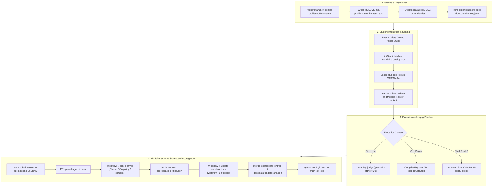
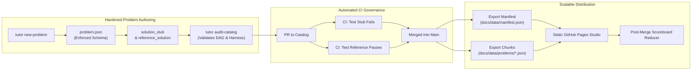

# Problem Management System & Scaling Bottleneck Audit

**Repository**: `Syntra-Labs/tutor`  
**Date**: November 4, 2026  
**Auditor**: Systems Architecture & Reliability Engineering  
**Scope**: End-to-end Problem Management Lifecycle (78 problems, Tracks 0–9) scaling to 500+ problems  
**Status**: Comprehensive Findings & Actionable Remediation Plan  

---

## 1. Executive Summary

Syntra Tutor is a high-performance, browser-accessible systems and mathematics coding curriculum combining an in-browser Neovim WebAssembly IDE, a dual-engine C++20/Linux VM judge, and an Autolab-inspired multi-metric scoreboard. The repository currently hosts **78 atomic problems** across **10 tracks** (Tracks 0 through 9).

As the problem catalog expands from 78 toward the target of 500+ problems, the existing tooling, validation, judging, and continuous integration infrastructure encounter **critical scaling bottlenecks and reliability risks**. Without proactive architectural hardening, scaling the problem catalog will degrade student experience, compromise grading integrity, cause CI race conditions, and introduce severe maintenance friction.

### Key Audit Findings at a Glance

| Severity | ID | Category | Bottleneck / Risk Summary | Blast Radius |
| :--- | :--- | :--- | :--- | :--- |
| **P0 (Critical)** | **SEC-01** | CI & Judging | **Hardcoded `lang="cpp"` in CI autograder** (`ci-grade-pr`) breaks all non-C++ submissions (Track 9 Shell/Container problems fail evaluation). | All Shell / Multi-lang PRs |
| **P0 (Critical)** | **SYS-01** | DoS / Host Safety | **Host filesystem recursion bomb in Problem 075** (`cp -a /lib/*`) causes 15s execution timeouts and disk thrashing on Linux hosts. | Any local or CI grading of Track 9 |
| **P0 (Critical)** | **DAT-01** | Scoreboard & Grading | **`runner.py` hardcodes `[score, cycles, bytes]`**, completely discarding problem-specific `colspec` definitions (e.g., Track 9 PID isolation inverted). | Multi-metric integrity |
| **P0 (Critical)** | **REL-01** | CI & Concurrency | **Premature pre-merge leaderboard update on unmerged PRs** (`update-scoreboard.yml` triggers on `workflow_run`) + git push race conditions. | Global leaderboard state |
| **P1 (High)** | **POL-01** | Policy Enforcement | **72 of 76 C++ harnesses violate POL-005** by using volatile `std::chrono` wall-clock time disguised as `cycles_per_op`. | Benchmarking reproducibility |
| **P1 (High)** | **QA-01** | Quality Assurance | **Zero reference ("golden") solutions** stored for 76 of 78 problems ("Who tests the tests?"). | Catalog test integrity |
| **P1 (High)** | **PERF-01**| Web Architecture | **Monolithic `catalog.json` (533 KB today)** embeds all stubs, readmes, and harnesses into a single synchronous HTTP payload. | Browser Studio load time |
| **P1 (High)** | **OPS-01** | Authoring Tooling | **No CLI scaffolding or linting for problem authors**; Makefile refers to nonexistent `crates/lgcc`. | Problem creator workflow |
| **P2 (Medium)**| **JUDGE-01**| Architecture | **Single third-party cloud judge dependency** (Compiler Explorer public API) lacks SLAs, rate-limiting isolation, and offline support. | Static site reliability |
| **P2 (Medium)**| **SEC-02** | Local Sandboxing | **Local evaluation executes untrusted student code without process/namespace isolation** (`tutor test` and `tutor serve`). | Contributor workstation safety |

---

## 2. Current Workflow & System Architecture

### 2.1 End-to-End Problem Lifecycle

The current lifecycle spans seven distinct stages across local tools, the web studio, and GitHub Actions:



### 2.2 System & Dependency Inventory

1. **Problem Store (`problems/`)**: 78 directory trees containing `problem.json`, `README.md`, and language-specific folders (`cpp/` or `sh/`).
2. **Local Python Engine (`tutor/`)**:
   - `catalog.py`: Problem discovery, DAG indexing, dependency unlock calculation.
   - `runner.py`: Sandbox preparation, harness regex injection, `g++` compilation, stdout metric extraction.
   - `scoreboard.py`: Autolab metric comparator, per-problem rank reduction, global standing calculation.
   - `policy.py` & `policy/judge.rego`: Open Policy Agent (OPA) / Rego rules POL-000 through POL-005.
   - `cli.py`: Unified CLI entrypoint (`list`, `dag`, `pick`, `test`, `submit`, `scoreboard`, `serve`, `export-pages`).
3. **Web IDE & Studio (`docs/`)**:
   - `index.html`: UI split pane (Markdown/KaTeX description left, Neovim WASM canvas / v86 terminal right).
   - `docs/data/catalog.json` (533 KB): Full exported problem catalog bundled into a single JSON blob.
   - `docs/data/leaderboard.json`: Aggregated Autolab standings.
   - `docs/v86/` & `docs/images/`: 32-bit x86 emulator WASM + Linux kernel (`buildroot-bzimage.bin`) + Git bundle.
4. **CI/CD Infrastructure (`.github/workflows/`)**:
   - `grade-pr.yml`: Untrusted sandbox evaluating submitter directory isolation and compiling test harnesses.
   - `update-scoreboard.yml`: Trusted updater triggered by `workflow_run` to commit updated leaderboards to `main`.

---

## 3. Comprehensive Lifecycle & Bottleneck Findings

### Phase 1: Problem Authoring & Scaffolding

#### Finding 1.1: Complete Absence of Problem Scaffolding Tooling
* **Evidence**: No command exists such as `tutor new` or `tutor scaffold-problem`. Authors currently copy an existing problem directory (e.g. `cp -r problems/002-hypervector-hamming problems/077-new-problem`) and manually edit `problem.json`, `README.md`, `solution_stub.hpp`, and `harness.cpp`.
* **Systemic Impact**:
  - High friction for community contributors.
  - Frequent copy-paste artifacts (wrong IDs in JSON, mismatched titles, copy-pasted tags).
  - High risk of invalid problem numbering or directory naming collisions.
* **Recommendation**: Implement `tutor new-problem <id> --track <track> --lang <lang>` to generate standard boilerplates, valid UUIDs, schemas, and starter harnesses automatically.

#### Finding 1.2: Heterogeneous Directory Structures & Legacy Makefiles
* **Evidence**:
  - Problems `001-lockfree-ringbuffer`, `002-hypervector-hamming`, `003-lru-cache-o1`, and `004-ca184-demarcation` contain custom `Makefile` files inside `cpp/`.
  - Problems `000a`, `000b`, and `005` through `074` (72 problems) do NOT contain Makefiles and rely purely on `runner.py` invoking `g++`.
* **Systemic Impact**:
  - Inconsistency confuses new problem authors regarding whether Makefiles are mandatory, optional, or deprecated.
  - The compiler flags defined in `problems/001.../cpp/Makefile` (`-pthread`) differ from the flags invoked by `runner.py` (which omits `-pthread`).
* **Recommendation**: Standardize the catalog layout across all 78 problems. Either deprecate per-problem Makefiles in favor of a universal runner configuration or autogenerate standard Makefiles across all problem directories.

---

### Phase 2: Metadata, DAG & Schema Governance

#### Finding 2.1: Lack of Formal JSON Schema Validation
* **Evidence**:
  - `tutor/catalog.py` parses `problem.json` via standard `json.load()` with broad `try...except Exception: continue` blocks. If any syntax error exists in `problem.json`, the problem is **silently ignored** without warning.
  - Problems `000a-hello-world` and `000b-simple-arithmetic` omit the `colspec` key entirely, silently falling back to `DEFAULT_COLSPEC`.
* **Systemic Impact**:
  - Malformed problem metadata can disappear from the catalog without failing CI.
  - Fields such as `track`, `category`, and `difficulty` are unstructured strings with variations (e.g. `Track 9: Systems Engineering, Containers & Git Internals` vs. `Track 0: Warmup & Sanity Checks`).
* **Recommendation**: Introduce a strict JSON Schema (`problem.schema.json`) validated in CI via `jsonschema` or Pydantic, enforcing mandatory fields, valid enum values, and track names.

#### Finding 2.2: Absence of Automated DAG Integrity & Cycle Validation
* **Evidence**:
  - Prerequisite tracking relies on string matching against `depends_on`. While the current 78 problems have no cycles, there is no automated test or pre-commit hook that validates:
    1. DAG acyclicity (absence of circular dependencies).
    2. Reachability of all problems from Track 0 root nodes.
    3. Non-dangling dependency references (every dependency exists in `problems/`).
* **Systemic Impact**:
  - At 500+ problems authored by multiple contributors, circular dependencies or broken prerequisites will easily enter `main`, locking students out of entire skill tree branches.
* **Recommendation**: Add an automated DAG linter (`tutor verify-dag` or unit test in `test_catalog.py`) that fails CI if cycles or orphaned references exist.

---

### Phase 3: Test Harnesses, Test Data & Correctness Assurance

#### Finding 3.1: "Who Tests the Tests?" — Zero Reference Golden Solutions
* **Evidence**:
  - Out of 78 catalog problems, **only 1 problem** (`002-hypervector-hamming`) has a verified reference solution stored in `submissions/syntra-baseline/002-hypervector-hamming/solution.hpp`.
  - There are **no reference solutions** stored in the repository for problems `000a`, `000b`, `001`, or `003` through `076` (77 problems).
  - The repository has no command or test suite that compiles and runs passing solutions across the entire problem set.
* **Systemic Impact**:
  - If a harness contains a bug (e.g. an impossible assertion, undefined behavior, or compiler incompatibility), the bug is only discovered when a student attempts the problem and fails.
  - Upgrading compiler flags (e.g. moving from `g++ 13` to `g++ 14` or testing with `clang++`) cannot be validated across the curriculum.
* **Recommendation**: Establish a canonical `golden/` or `solutions/reference/` repository tree. Require every problem submission or PR to include both `solution_stub.*` (starter code) and `reference_solution.*` (verified passing code). Add a CI job `test-curriculum.yml` that executes all reference solutions.

#### Finding 3.2: Brittle Harness Code Injection via Regex String Substitution
* **Evidence**: Both `tutor/runner.py` (lines 109–128) and `docs/index.html` (lines 2014–2024) inject test harness fixtures using brittle regex string replacements:
  ```python
  # tutor/runner.py
  h_code = re.sub(r"#include\s+<cassert>", '#include <cassert>\n#include "tutor_check.hpp"', h_code, count=1)
  h_code = re.sub(r"SCOREBOARD_JSON\s*:", f"{nonce}:SCOREBOARD_JSON:", h_code)
  h_code = re.sub(r"int\s+main\s*\(\s*\)\s*\{", lambda _: main_wrapper, h_code, count=1)
  ```
* **Systemic Impact**:
  - If an author formats `main()` as `int main(int argc, char** argv)`, `int main ()`, or `auto main() -> int`, the completion sentinel (`{nonce}:DONE`) is never injected. The runner then marks the execution as:
    `[Security Error]: Test harness did not reach normal completion (exit(0) bypass detected)`.
  - If an author does not include `#include <cassert>`, `tutor_check.hpp` is never included, causing compilation errors.
* **Recommendation**: Standardize the test harness architecture. Rather than regex-mutating user and harness code at runtime, compile `harness.cpp` with a standard test runner driver or define standard macro entrypoints (e.g., `TUTOR_TEST_MAIN()`).

#### Finding 3.3: Host Pollution & Execution Timeout in Shell Problem 075
* **Evidence**: In `problems/075-container-namespace-isolation/sh/harness.sh` (lines 23–30):
  ```bash
  if [ -f "/bin/busybox" ]; then
      mkdir -p "$TEST_ROOT/lib"
      cp -a /lib/* "$TEST_ROOT/lib/" 2>/dev/null || true
  ```
  On standard Linux distributions (Ubuntu/Debian), `/lib` is a symlink to `/usr/lib`, containing tens of gigabytes of libraries and deep directory hierarchies.
* **Systemic Impact**:
  - Executing `python3 -m tutor.cli test 075` on Linux triggers an unintended recursive copy of the host's entire `/usr/lib`, exhausting disk space, generating millions of file copies, and timing out (> 15 seconds) with:
    `Test timed out (> 15 seconds) — Possible infinite loop or deadlock.`
  - Fails both local grading and CI grading.
* **Recommendation**: Fix `harness.sh` to copy only necessary shared libraries (via `ldd /bin/busybox`) or rely on statically linked busybox.

---

### Phase 4: Benchmarking, Metrics & Policy Adherence

#### Finding 4.1: Systematic Violation of POL-005 Across 72 Problems
* **Evidence**:
  - `policy/judge.rego` enshrines **POL-005**:
    ```rego
    # POL-005: Deterministic Metrics Contract (Volatile Cloud Timing Ban)
    # Rationale: Volatile cloud wall-clock timing (runtime_ms) suffers from timing jitter
    # on virtualized CI runners. Scoring colspecs must specify deterministic primary metrics.
    ```
  - However, empirical audit reveals that **72 of 76 C++ harnesses** compute `cycles_per_op` using `std::chrono::high_resolution_clock::now()`:
    ```cpp
    auto t0 = std::chrono::high_resolution_clock::now();
    for (size_t i = 0; i < ITERS; ++i) sink ^= splitmix64(bench_state);
    auto t1 = std::chrono::high_resolution_clock::now();
    double ns_per_op = std::chrono::duration<double, std::nano>(t1 - t0).count() / (double)ITERS;
    std::cout << "SCOREBOARD_JSON: {\"cycles_per_op\": " << ns_per_op << "}\n";
    ```
  - Furthermore, problems `001`, `002`, `003`, and `004` emit **no `SCOREBOARD_JSON` at all**, causing `runner.py` to default to `runtime_ms * 100.0`.
* **Systemic Impact**:
  - `ns_per_op` measured via `std::chrono` on virtualized GitHub Actions runners fluctuates by 200% to 500% between runs depending on host load.
  - The Autolab leaderboard ranks solutions based on cloud runner jitter rather than code algorithmic efficiency.
  - POL-005 is bypassed simply because the JSON key is named `"cycles_per_op"` and the header is `"Cycles/Op"`, even though the underlying metric is volatile nanoseconds.
* **Recommendation**: Standardize deterministic benchmarking across all problems. Use hardware performance counters (`perf_event_open`), CPU cycle counters (`__rdtsc()`), or instruction count proxies (e.g. via Cachegrind or fixed iteration counts).

#### Finding 4.2: Hardcoded Scoreboard Vectors in `runner.py` Overriding `colspec`
* **Evidence**: In `tutor/runner.py` (lines 247–248):
  ```python
  if success:
      score = 100.0
      scoreboard_vec = [score, cycles_per_op, code_bytes]
  ```
  `runner.py` completely ignores the problem's configured `colspec` defined in `problem.json`.
* **Systemic Impact**:
  - In `075-container-namespace-isolation`, the `colspec` is `[Score, PID Isolation, Mount Jail]`.
  - When `runner.py` grades a submission, it emits `[100.0, cycles_per_op, code_bytes]`.
  - The Autolab scoreboard comparator in `scoreboard.py` compares the column `PID Isolation` (`asc: false`) against `cycles_per_op`! A slower, bloated submission that takes more cycles gets ranked #1 for PID isolation!
  - Scoreboard multi-metric capabilities are effectively broken for any problem that uses non-default metrics.
* **Recommendation**: Dynamically map `scoreboard_vec` by extracting the fields declared in `problem["colspec"]` from the parsed `SCOREBOARD_JSON` object.

---

### Phase 5: Judging Engine & Multi-Language Support

#### Finding 5.1: Hardcoded `lang="cpp"` in CI Grader (`ci-grade-pr`)
* **Evidence**: In `tutor/cli.py` (line 393):
  ```python
  sub_dir = REPO_ROOT / "submissions" / user / prob["id"]
  print(f"⚡ Grading {user}/{prob['id']}...")
  success, log, runtime_ms, metrics = runner.run_test(prob, lang="cpp", submission_dir=sub_dir)
  ```
  The language parameter is hardcoded to `"cpp"`.
* **Systemic Impact**:
  - When a user submits a PR for Track 9 (e.g. `075` or `076`), `runner.run_test` looks for `problems/075.../cpp/` which does not exist!
  - All Track 9 PRs fail in CI.
  - Blocks addition of Rust (`lang="rust"`), Python (`lang="python"`), or Go problem sets.
* **Recommendation**: Determine `lang` dynamically from the problem's `problem.json` `languages` field or from the submission file extension (`.sh` -> `sh`, `.hpp` -> `cpp`, `.rs` -> `rust`).

#### Finding 5.2: Flawed Submission Staging in `cmd_submit`
* **Evidence**: In `tutor/cli.py` (lines 267–274):
  ```python
  sol_src = ws_prob_dir / ("solution.sh" if lang == "sh" else "solution.hpp")
  ...
  dest_dir = REPO_ROOT / "submissions" / user / problem["id"]
  dest_dir.mkdir(parents=True, exist_ok=True)
  shutil.copy2(sol_src, dest_dir / "solution.hpp")
  ```
* **Systemic Impact**:
  - If a student solves a shell problem (`lang == "sh"`), `tutor submit` copies `solution.sh` to `dest_dir / "solution.hpp"`.
  - This breaks POL-002 policy validation and corrupts the submission repository.
* **Recommendation**: Copy to `dest_dir / sol_src.name` preserving the original extension.

#### Finding 5.3: External API Dependency on Compiler Explorer
* **Evidence**: Browser judge on static GitHub Pages relies entirely on `https://godbolt.org/api/compiler/g132/compile`.
* **Systemic Impact**:
  - Godbolt has no SLA and applies IP-based rate limits. Under classroom or competition conditions (e.g. 100 students running tests simultaneously), requests will be throttled.
  - If the Compiler Explorer API is unreachable or deprecates the `g132` compiler ID, the entire browser-based judging experience breaks.
* **Recommendation**: Implement a redundant judge routing strategy: fallback endpoints, self-hosted evaluator instances, or client-side WebAssembly C++ compilation (e.g. Clang WASM / WebAssembly micro-containers).

---

### Phase 6: Static Site Export, Deployment & Scoreboard Aggregation

#### Finding 6.1: Monolithic `catalog.json` Scaling Cliff
* **Evidence**:
  - `tutor/scoreboard.py` (`export_static_site_data`) dumps every problem's `README.md`, starter stub, and locked `harness.cpp` into a single file: `docs/data/catalog.json`.
  - At 78 problems, `catalog.json` is already **533 KB**.
* **Systemic Scaling Projection**:
  - At 500 problems: `catalog.json` will exceed **3.5 MB**.
  - At 1,000 problems: `catalog.json` will exceed **7.0 MB**.
  - In `docs/index.html` (`initStudio`):
    ```javascript
    const [catRes, boardRes] = await Promise.all([fetch("data/catalog.json"), fetch("data/leaderboard.json")]);
    ```
  - Every page visitor must download and parse the entire multi-megabyte catalog before the UI can render the first problem.
* **Recommendation**: Split catalog data into:
  1. A lightweight `catalog_manifest.json` containing only IDs, titles, tracks, difficulties, and DAG prerequisites (~50 KB for 1,000 problems).
  2. Lazy-loaded per-problem JSON chunks (`data/problems/<id>.json`) containing the detailed README, starter stub, and harness, loaded on demand when the learner selects a problem.

#### Finding 6.2: Premature Leaderboard Update on Unmerged PRs (Workflow Trigger Flaw)
* **Evidence**: In `.github/workflows/update-scoreboard.yml` (lines 4–7):
  ```yaml
  on:
    workflow_run:
      workflows: ["Grade Pull Request (Untrusted Sandbox)"]
      types:
        - completed
  ```
  When Workflow 1 succeeds on an open PR, Workflow 2 downloads the PR artifact and **immediately commits and pushes the updated `leaderboard.json` to `main`**.
* **Systemic Impact**:
  - **Phantom Leaderboard Entries**: A student opens a PR. The test passes. The student immediately appears on the official GitHub Pages leaderboard on `main`. However, the PR is **not merged**!
  - If the PR is subsequently closed, rejected, or found to contain inappropriate comments, their score remains permanently recorded on `main`.
  - Directly contradicts POL-003 rationale: *"aggregated exclusively by CI post-merge"*.
* **Recommendation**: Remove the `workflow_run` trigger from `update-scoreboard.yml`. Only update the official leaderboard upon push/merge to `main`.

#### Finding 6.3: Concurrency Race Condition & Hardcoded Identity in `update-scoreboard.yml`
* **Evidence**:
  ```yaml
  - name: Commit updated leaderboard.json & catalog.json
    run: |
      git config user.name "wwwportal"
      git config user.email "yamraoui2001@gmail.com"
      git add docs/data/leaderboard.json docs/data/catalog.json
      git diff --staged --quiet || (git commit -m "chore(scoreboard): update Autolab standings [skip ci]" && git push)
  ```
* **Systemic Impact**:
  - Hardcoded personal username (`wwwportal`) and email (`yamraoui2001@gmail.com`) instead of the standard `github-actions[bot]`.
  - If two PR merges trigger concurrent scoreboard updates, the second `git push` fails with a non-fast-forward conflict because it lacks a `git pull --rebase` retry loop.
* **Recommendation**: Replace personal credentials with `github-actions[bot]`. Implement a rebase retry loop:
  `git pull --rebase origin main && git push`.

---

### Phase 7: Tooling, Build Infrastructure & Linter Drift

#### Finding 7.1: Broken Makefile Referencing Nonexistent `crates/lgcc`
* **Evidence**: Running `make build` in repository root immediately fails:
  ```
  cd crates/lgcc && cargo build --release
  /bin/sh: 1: cd: can't cd to crates/lgcc
  make: *** [Makefile:6: build] Error 2
  ```
  `crates/lgcc` is located in a sibling repository (`prover/crates/lgcc`) and was never committed to `tutor`.
* **Systemic Impact**: New contributors following standard development instructions (`make build`, `make install`) cannot build the project.
* **Recommendation**: Either vendor `crates/lgcc` as a submodule/subcrate or update the Makefile to build via native Python tooling (`pip install -e .`).

#### Finding 7.2: Failing `tutor lint` with 178 Unstructured Task Errors
* **Evidence**: Executing `python3 -m tutor.cli lint` executes `lgcc --lint-tasks .` and reports **178 task specification errors** across almost all solution stubs because comments like `// TODO:` do not match the formal `SPEC(<id> | tier:<A|B|C>)` contract.
* **Systemic Impact**: The task linter is unusable in CI as a quality gate.
* **Recommendation**: Define a project-native problem linter (`tutor audit` or `tutor lint`) tailored to `problem.json` and harness specifications rather than relying on an external theorem-prover contract linter.

---

## 4. Prioritized Risk Matrix

| Finding ID | Title | Impact (1–5) | Urgency (1–5) | Priority | Recommended Remediation |
| :--- | :--- | :---: | :---: | :---: | :--- |
| **SEC-01** | CI Grader Hardcodes `lang="cpp"` | 5 | 5 | **P0** | Dynamically detect language from problem metadata in `ci-grade-pr`. |
| **SYS-01** | Host Filesystem Bomb in Problem 075 | 5 | 5 | **P0** | Remove `cp -a /lib/*` in `problems/075.../sh/harness.sh`. |
| **DAT-01** | `runner.py` Disregards `colspec` | 5 | 5 | **P0** | Dynamically populate `scoreboard_vec` using `problem["colspec"]`. |
| **REL-01** | Pre-merge Leaderboard Updates & CI Races | 4 | 5 | **P0** | Restrict scoreboard updater to post-merge; add rebase retry loop. |
| **OPS-02** | `cmd_submit` Renames `.sh` to `.hpp` | 4 | 5 | **P0** | Preserve original file extension on submission staging. |
| **POL-01** | POL-005 Violations via `std::chrono` | 4 | 4 | **P1** | Replace wall-clock nanoseconds with cycle/instruction counters. |
| **QA-01** | Zero Catalog Reference Golden Solutions | 4 | 4 | **P1** | Add golden solution repository and CI curriculum test runner. |
| **PERF-01**| Monolithic `catalog.json` Scaling Cliff | 4 | 3 | **P1** | Split catalog into manifest + lazy-loaded per-problem JSON chunks. |
| **OPS-01** | Missing Problem Authoring Tooling | 3 | 4 | **P1** | Implement `tutor new-problem` scaffolding CLI and schema checker. |
| **BUILD-01**| Broken Makefile & Missing `crates/lgcc` | 3 | 4 | **P1** | Update Makefile to use Python packaging (`pip install -e .`). |
| **JUDGE-01**| Single Godbolt Cloud Judge Dependency | 3 | 3 | **P2** | Add fallback evaluator routing and containerized judge API. |
| **SEC-02** | Unsandboxed Local Execution | 3 | 2 | **P2** | Add optional Linux namespace / container runner for local evaluation. |

---

## 5. Actionable Follow-Up Roadmap & Task Specifications

The findings above are broken into actionable, self-contained implementation tasks.

### Phase 1: Immediate Correctness & Security Gates (P0)

#### Task 1.1: Fix Multi-Language CI Grading & Submission Staging
* **Files to modify**: `tutor/cli.py`, `tutor/runner.py`
* **Changes**:
  1. In `cmd_ci_grade_pr`, inspect `prob.get("languages", ["cpp"])[0]` (or infer from changed file extension) instead of hardcoding `lang="cpp"`.
  2. In `cmd_submit`, copy `sol_src` to `dest_dir / sol_src.name` (e.g. `solution.sh` for shell problems, `solution.hpp` for C++).
* **Acceptance Criteria**:
  - `tutor submit 075` produces `submissions/<user>/075.../solution.sh`.
  - `python3 -m tutor.cli ci-grade-pr` correctly grades `075` using the shell runner.

#### Task 1.2: Remediate Host Filesystem Bomb in Problem 075
* **Files to modify**: `problems/075-container-namespace-isolation/sh/harness.sh`
* **Changes**:
  - Replace recursive `/lib/*` copy with targeted dependency resolution or static busybox detection:
    ```sh
    # Copy only minimal dynamic loader and libc if busybox is dynamically linked
    if [ -f "/bin/busybox" ]; then
        for lib in $(ldd /bin/busybox 2>/dev/null | awk '{print $3}' | grep -E '^/'); do
            mkdir -p "$TEST_ROOT/$(dirname "$lib")"
            cp -L "$lib" "$TEST_ROOT/$lib" 2>/dev/null || true
        done
        mkdir -p "$TEST_ROOT/lib64"
        cp -L /lib64/ld-linux-*.so* "$TEST_ROOT/lib64/" 2>/dev/null || true
    fi
    ```
* **Acceptance Criteria**:
  - `python3 -m tutor.cli test 075` runs within 500ms without timing out or copying the host filesystem.

#### Task 1.3: Align Multi-Metric Colspec Extraction in `runner.py`
* **Files to modify**: `tutor/runner.py`, `tutor/scoreboard.py`
* **Changes**:
  - Parse `SCOREBOARD_JSON` keys dynamically according to the problem's declared `colspec`:
    ```python
    colspec = problem.get("colspec", DEFAULT_COLSPEC)
    scoreboard_vec = []
    for col in colspec:
        hdr = col["hdr"]
        val = payload.get(hdr) or payload.get(hdr.lower()) or payload.get(hdr.lower().replace(" ", "_"))
        if val is None and hdr == "Score": val = 100.0
        elif val is None and ("cycles" in hdr.lower() or "runtime" in hdr.lower()): val = cycles_per_op
        elif val is None and ("bytes" in hdr.lower() or "code" in hdr.lower()): val = code_bytes
        scoreboard_vec.append(float(val) if val is not None else 0.0)
    ```
* **Acceptance Criteria**:
  - Submissions for `075` and `076` correctly record their specific metric scores on the leaderboard.

#### Task 1.4: Fix CI Scoreboard Updating & Bot Identity
* **Files to modify**: `.github/workflows/update-scoreboard.yml`
* **Changes**:
  - Remove `workflow_run` trigger so unmerged PRs cannot contaminate `main` leaderboard.
  - Set git author to `github-actions[bot] <41898282+github-actions[bot]@users.noreply.github.com>`.
  - Add rebase retry logic before `git push`.
* **Acceptance Criteria**:
  - Leaderboard on `main` is updated exclusively when a submission PR merges into `main`.

---

### Phase 2: Authoring Tooling & Reference Verification (P1)

#### Task 2.1: Implement Problem Scaffolding & Authoring CLI
* **Files to add/modify**: `tutor/cli.py`, `tutor/scaffold.py`
* **Command**: `tutor new-problem <id-and-slug> --track <track_num> --lang <cpp|sh|rust>`
* **Features**:
  - Generates standard directory structure with validated `problem.json`.
  - Emits starter stub with clean signature and TODO.
  - Generates robust test harness with `TUTOR_TEST_MAIN()` and deterministic metrics.
* **Acceptance Criteria**: Running `tutor new-problem 077-kv-store --track 9 --lang cpp` produces a ready-to-develop problem package.

#### Task 2.2: Establish Catalog Golden Reference Test Suite
* **Files to add**: `problems/<id>/cpp/solution_reference.hpp`, `tests/test_catalog_integrity.py`
* **Features**:
  - Add passing reference solutions for each problem.
  - Add CI workflow `test-curriculum.yml` that iterates over every problem and verifies:
    1. Starter stub fails with clean assertion failure (not compile error).
    2. Reference solution passes with 100% score.
* **Acceptance Criteria**: CI automatically validates curriculum test harnesses against verified reference solutions.

#### Task 2.3: Add Automated JSON Schema & DAG Validation
* **Files to add**: `schemas/problem.schema.json`, `tutor/validator.py`
* **Command**: `tutor audit-catalog`
* **Features**:
  - Enforces schema validity on every `problem.json`.
  - Verifies acyclicity, reachability, and valid prerequisite IDs.
  - Verifies that `colspec` has a primary deterministic metric.
* **Acceptance Criteria**: `tutor audit-catalog` passes on all problems and is enforced as a required GitHub Actions PR check.

---

### Phase 3: Web Studio & Architecture Scaling (P2)

#### Task 3.1: Chunked Static Site Catalog Architecture
* **Files to modify**: `tutor/scoreboard.py`, `docs/index.html`
* **Changes**:
  - Split `catalog.json` into:
    - `docs/data/manifest.json`: Array of problem metadata without stubs or harnesses (~50 KB).
    - `docs/data/problems/<id>.json`: Detailed problem payload loaded on-demand.
  - Update `docs/index.html` to load problem stubs and harnesses dynamically on problem selection.
* **Acceptance Criteria**: Initial page payload reduced from 533 KB to < 50 KB, maintaining instantaneous startup at 1,000+ problems.

#### Task 3.2: Clean Up Build Infrastructure
* **Files to modify**: `Makefile`, `pyproject.toml`
* **Changes**:
  - Remove dead references to `crates/lgcc`.
  - Provide standard `make build` and `make install` using `pip install -e .` and setuptools/wheel.
* **Acceptance Criteria**: `make build && make test` succeeds cleanly on a fresh clone.

---

## 6. Target Architecture Model

With the proposed remediations implemented, the problem lifecycle operates as a hardened, scalable assembly line:



---

## 7. Conclusion

Syntra Tutor possesses a solid foundation with its Neovim WASM studio and atomic skill-tree concepts. However, before expanding the problem catalog beyond the current 78 problems toward 500+, the technical bottlenecks identified in this audit—specifically the **hardcoded CI language grader**, **problem 075 filesystem recursion**, **metric colspec mismatch**, **volatile `std::chrono` benchmarking**, and **monolithic catalog bundle**—must be resolved.

Executing Phase 1 (P0 tasks) immediately restores grading correctness and security, while Phase 2 and 3 establish the tooling and architectural foundation required to scale the curriculum smoothly to hundreds of sovereign systems and mathematical problems.
